# dfAmmo - 《三角洲行动》自动化卡邮件助手

`dfAmmo` 是一款专为《三角洲行动》（*Delta Force*）打造的**自动化卡邮件**辅助工具。

项目以 **Airtest** 视觉图像识别为核心驱动，配合精准的动态窗口定位与 Win32 原生交互，彻底攻克了传统脚本“窗口一动就点偏”的致命痛点，实现全流程极度稳定的全自动卡邮件体验。

---

## 💡 为什么选择 dfAmmo？

市面上常见的游戏脚本大多依赖固定的屏幕坐标进行盲点，存在以下硬伤：
- ❌ **窗口不能动**：游戏窗口只要被移动、拖拽或未居中，点击立刻错位脱靶；
- ❌ **分辨率缩放漂移**：系统设置了 125% 或 150% DPI 缩放时，坐标容易错位；
- ❌ **权限不足被拦截**：普通权限脚本无法向管理员权限运行的 WeGame 或游戏进程发送键鼠指令。

### 🌟 dfAmmo 的核心破局点：Airtest 动态 UI 匹配
本项目**核心依托 Airtest 自动化图像定位技术**：
1. **实时窗口追踪**：在每次执行点击前，程序会动态重新获取目标窗口的最新句柄（HWND）与实时坐标包围盒（Bounding Box）。
2. **动态模板匹配与映射**：通过图像特征识别实时找出按钮在窗口内部的相对位置，再动态换算至当前物理屏幕坐标。
3. **窗口随意移动无压力**：**无论你在使用过程中如何随意拖动、拉扯或改变游戏窗口位置，工具均能实时跟进，自动精准定位 UI 元素，绝不会出现因移动窗口导致点击位置错误的情况！**

---

## 🎯 核心功能：自动化卡邮件全流程

点击 **“开始卡邮件”** 后，程序将接管并自动执行以下流水线：

```mermaid
flowchart LR
    A[WeGame 识别] -->|Airtest识别点击| B[启动游戏]
    B -->|进程监控| C[游戏载入]
    C -->|跳过活动弹窗| D[进入烽火地带大厅]
    D -->|选图长弓溪谷| E[确认配装与出发]
    E -->|Airtest监控选人界面| F[到达选人界面]
    F -->|强退进程| G[安全终止游戏]
    G -->|文件操作| H[重命名关键 Pak 缓存]
    H -->|等待就绪| I[WeGame 启动按钮重新出现]
    I -->|打开管理| J[点击更多 -> 游戏资源包管理]
    J -->|删包操作| K[弹窗中删除长弓溪谷资源包]
    K -->|重启游戏| L[再次点击启动按钮拉起游戏]
```



1. **智能启动识别**：在 WeGame 中动态识别并点击“启动游戏/进入游戏”按钮；
2. **进程拉起检测**：实时监听 `DeltaForceClient-Win64-Shipping.exe` 进程状态；
3. **模式自动选择**：自动识别并进入“烽火地带”模式；
4. **弹窗智能跳过**：模拟按键快速关闭活动与公告弹窗，Tab 进入大厅；
5. **自动化备战出发**：自动打开地图列表 $\rightarrow$ 选择“长弓溪谷” $\rightarrow$ 开始行动 $\rightarrow$ 确认配装 $\rightarrow$ 点击出发；
6. **毫秒级选人界面判定**：利用 Airtest 图像识别毫秒级监控进入选人界面的关键标志帧（`df_operator_select.png`）；
7. **强退与文件处理**：
   - 识别到选人界面后立即安全终止游戏客户端进程；
   - 打开游戏资源 `Paks` 目录，将关键缓存文件（`pak-0-2-pakchunk90-WindowsClient.pak` 及赛季新增的 `pak-0-2-pakchunk90optional-WindowsClient.pak`）自动重命名为 `.disabled`；
8. **WeGame 删包与重新拉起游戏**：
   - 重新激活并切回 WeGame 主界面，等待启动按钮重新亮起；
   - 自动点击更多（`wegame_more.png`）并进入“游戏资源包管理”（`wegame_assets_manage.png`）；
   - 在弹出的新管理窗口中定位并点击删除“长弓溪谷”资源包（`wegame_delete_map.png`）；
   - 切回 WeGame 主窗口重新点击启动按钮，拉起游戏完成全套作业！

---

## 🎮 运行模式（UI 模式切换）

主界面功能区提供两种运行模式切换：
- 🔘 **半自动模式（手动购入穿戴）**：适合玩家手动选配想要卡的装备与物资。
- 🔘 **全自动模式（配装方案一键买齐）**：依托配装方案自动化一键买齐。具体配装点击细节支持进一步拓展定制。

---

## ✨ 其它技术特性

- 🎯 **一拉即绑（窗口绑定器）**：提供按住拖拽的取窗交互，拖动光标至 WeGame 窗口后松开即可秒级绑定目标。
- 🛡️ **UAC 自动提权与 UIPI 保护**：启动时自动检测管理员权限，必要时唤起 UAC 授权，彻底攻克 Windows 用户界面特权隔离机制，确保键鼠模拟必达。
- 🖥️ **Per-Monitor DPI V2 兼容**：引入物理像素上下文切换，在任意系统缩放（100%、125%、150% 等）下截图像素与鼠标物理坐标完全 1:1 对齐。
- 📸 **内置模板采集工具**：自带全屏半透明遮罩框选截图功能。游戏界面若有更新或画质有差异，随时一键框选生成新模板。
- 🖱️ **拟人化微扰动点击**：支持多通道点击兜底，并在目标区域内引入随机微偏移与微小延迟，贴近真人操作。

---

## 🚀 快速开始

### 方式一：双击一键启动（推荐）
直接运行根目录下的 `start.bat`：
- 若安装了 [uv](https://docs.astral.sh/uv/)，将自动同步依赖（`uv sync --frozen`）并拉起程序；
- 若已有现成 `.venv` 虚拟环境，将直接通过虚拟环境极速启动。

### 方式二：命令行启动

```bash
# 1. 使用 uv 安装与同步依赖
uv sync

# 2. 运行主程序（若非管理员将自动弹出 UAC 提权提示）
uv run main.py
```

---

## 📖 使用步骤

1. **设置游戏安装目录**：
   - 打开程序后，在主界面输入或通过 **“浏览”** 按钮选择游戏主目录（包含 `DeltaForce` 的目录，如：`D:/Program Files/Steam/steamapps/common/Delta Force/Game`）。路径会自动保存至 `config.json`。
2. **绑定 WeGame 窗口**：
   - 打开 WeGame 并停留在《三角洲行动》游戏页面；
   - 在本工具界面上，鼠标**按住**“按住拖到 WeGame 窗口后松开”按钮；
   - 拖拽光标到 WeGame 窗口任意区域后**松开鼠标**，完成绑定。
3. **一键卡邮件**：
   - 点击 **“开始卡邮件”**，程序开始全程自动作业；
   - **运行期间游戏窗口即便发生位移、拖动，程序依然基于视觉准确定位，无需刻意保持窗口绝对不动。**
4. **自定义/重新采图（可选）**：
   - 如因分辨率变化出现匹配超时，点击 **“采集元素模板”**；
   - 输入要更新的模板名（如 `df_operator_select`）；
   - 在全屏暗色选区内拖拽框选按钮区域，松开即可自动覆盖保存至 `assets/templates/`。

---

## ⚙️ 配置说明 (`config.json`)

```json
{
  "app_name": "dfAmmo",
  "window_title": "dfAmmo Assistant",
  "start_button_templates": [
    "wegame_start_button.png",
    "wegame_start_deltaforce.png",
    "start_button.png"
  ],
  "template_match_threshold": 0.78,
  "game_process_names": [
    "DeltaForceClient-Win64-Shipping.exe",
    "DeltaForceClient.exe"
  ],
  "game_process_poll_interval_ms": 1000,
  "game_process_timeout_seconds": 120,
  "navigation_poll_interval_ms": 700,
  "navigation_step_timeout_seconds": 60,
  "game_window_timeout_seconds": 90,
  "game_install_dir": "D:/Program Files/Steam/steamapps/common/Delta Force/Game",
  "pak_file_names": [
    "pak-0-2-pakchunk90-WindowsClient.pak",
    "pak-0-2-pakchunk90optional-WindowsClient.pak"
  ],
  "operation_mode": "semi_auto",
  "wegame_more_template": "wegame_more.png",
  "wegame_assets_manage_template": "wegame_assets_manage.png",
  "wegame_delete_map_template": "wegame_delete_map.png",
  "wegame_ready_timeout_seconds": 60,
  "delete_map_timeout_seconds": 30
}
```

| 参数项 | 说明 |
| :--- | :--- |
| `template_match_threshold` | 图像匹配相似度阈值（默认 0.78，建议在 0.75 ~ 0.85 之间） |
| `start_button_templates` | WeGame 启动按钮候选模板图名称列表 |
| `game_process_names` | 游戏可执行文件名识别列表 |
| `operation_mode` | 运行模式：`semi_auto`（半自动）或 `full_auto`（全自动） |
| `pak_file_names` | 卡邮件需要重命名的 Pak 目标文件列表（支持多个文件） |
| `wegame_more_template` | WeGame 更多按钮（三个点）模板图名称 |
| `wegame_assets_manage_template` | 游戏资源包管理菜单模板图名称 |
| `wegame_delete_map_template` | 删除长弓溪谷资源包按钮模板图名称 |
| `navigation_step_timeout_seconds`| 自动化每个步骤等待识别的最长超时时间（秒） |
| `game_install_dir` | 游戏根目录（包含 `DeltaForce` 的目录） |

---

## 📂 项目结构

```
dfAmmo/
├── main.py                     # 程序入口：DPI 设置、管理员权限检查与 UAC 提权
├── start.bat                   # 便捷启动批处理脚本
├── config.json                 # 运行参数与本地目录配置
├── pyproject.toml / uv.lock    # 项目依赖管理（核心依赖 airtest、pyside6、opencv 等）
├── assets/
│   └── templates/              # Airtest 图像匹配关键步骤模板
└── scripts/
    ├── app.py                  # Qt 应用程序初始化
    ├── gui.py                  # 主界面呈现、绑定事件与状态机驱动
    ├── workflow.py             # 卡邮件核心工作流（启动、杀进程、改 Pak）
    ├── game_navigation.py      # 卡邮件状态机步骤编排（NAVIGATION_STEPS）
    ├── element_locator.py      # Airtest / 视觉模板匹配引擎（支持动态窗口映射）
    ├── window_binding.py       # 实时窗口追踪与坐标激活
    ├── bind_button.py          # 拖拽绑定控件
    ├── template_capture.py     # 屏幕框选模板采集器
    ├── screenshot.py           # 物理像素截图服务
    ├── clicker.py              # 拟人化动态鼠标点击
    ├── keyboard.py             # 键盘模拟控制器
    ├── game_process.py         # 游戏主进程监控
    ├── privileges.py           # 管理员权限与 UIPI 安全检测
    ├── dpi.py                  # Per-Monitor DPI V2 物理映射
    └── styles.py               # QSS 样式表定义
```

---

## ❓ 常见问题

1. **为什么运行期间可以随意移动游戏或 WeGame 窗口？**
   - 因为本工具放弃了死板的“屏幕固定坐标模式”，每次操作前都会动态抓取窗口当前位置，并在其内部基于 Airtest 进行图像检索，换算出绝对坐标，因此窗口位置如何变动均不影响识别和点击。
2. **提示“步骤匹配超时”怎么办？**
   - 检查游戏画质/分辨率是否大幅变动导致模板不匹配；
   - 点击“采集元素模板”，框选报错步骤对应的界面按钮进行重新采图即可。
3. **提示缺少管理员权限？**
   - 程序在启动时会自动申请 UAC 管理员提权，请在系统提示中点击“是”。如果被手动拒绝，Windows 会阻止向 WeGame 和游戏窗口发送模拟操作。

---

## ⚠️ 免责声明

- 本项目仅用于个人学习交流 Python 自动化测试、Airtest 图像识别及 Windows API 交互原理，严禁用于任何商业牟利行为。
- 使用本自动化脚本所产生的一切后果由使用者自行承担。
